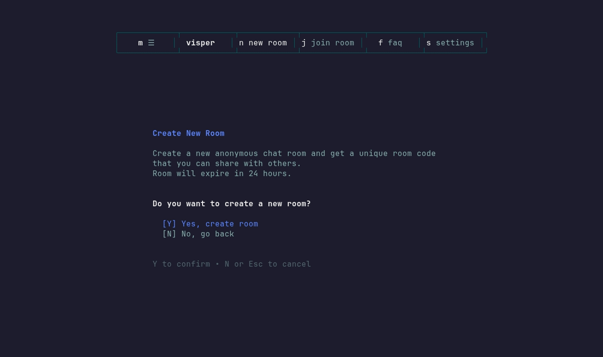

<div align="center">


# Visper

**Anonymous, end-to-end encrypted chat rooms, right from your terminal.**

[](https://github.com/HilthonTT/Visper/actions/workflows/ci.yml)
[](go.work)
[](LICENSE)

</div>

Spin up a throwaway room, share the join code or QR invite, and chat without an
account. Messages and shared files are encrypted on the client with a room key
that travels only inside invites, so the server only stores ciphertext and
never sees the key. Visper has a [Bubble Tea](https://github.com/charmbracelet/bubbletea)
TUI, a terminal-style web client, file and image sharing with inline previews,
and an optional "enhance my message" feature backed by a local
[Ollama](https://ollama.com) model.



More demos (QR invites, editing, image sharing, AI rewrite):
**[docs/demos](docs/demos/README.md)**.

The web client mirrors the TUI's layout (header tabs, footer key hints and
the companion panel) and joins rooms right in the browser, with the same
end-to-end encryption ([more demos](docs/demos/README.md#web-client),
[screenshots](clients/web/README.md#screenshots)):


## Quick start

Requires Docker and Go 1.27+.

```bash
git clone https://github.com/HilthonTT/Visper.git && cd Visper
cp .env.example .env
make up-app   # Postgres, Redis, Jaeger, Ollama + api, proxy, ai (docker compose --profile app up -d --build)
make cli      # start the TUI
```

To run the services on your machine with live reload, or without `make`, see
**[docs/local-development.md](docs/local-development.md)**.

## Repository layout

```
clients/
  cli/        visper terminal client: Go, Bubble Tea v2
  web/        terminal-style web client: React 19, TanStack Start, Vite
services/
  api/        REST + WebSocket backend: Go, Gin, GORM, Redis, OpenTelemetry
  proxy/      load balancer with hierarchical throttling: Go, Prometheus
  ai/         message-enhancement API + arq worker: Python, FastAPI, Ollama
sdk/go/       typed Go client for the API (used by the CLI)
docs/         local-development guide, demos (+ the VHS tapes that record them)
```

The CLI talks to the API through the SDK and, optionally, through the proxy.
The API stores rooms in Postgres and Redis (master/replica with Sentinel). The
AI service reads sessions from the same Redis and calls Ollama. The Go modules
are linked by [`go.work`](go.work).

## Development

```bash
make help    # all targets
make check   # what CI runs: gofmt, vet, golangci-lint, tests, ruff, pytest, biome, tsc, vitest
make build   # binaries into ./bin
```

See [CONTRIBUTING](.github/CONTRIBUTING.md). Report vulnerabilities privately
per [SECURITY](.github/SECURITY.md).

## Credits

[terminal.shop](https://www.terminal.shop/) (TUI inspiration) ·
[superfile](https://superfile.dev/) (file explorer) ·
[rcdmk/go-ratelimiter](https://github.com/rcdmk/go-ratelimiter) ·
[gofr-dev](https://github.com/gofr-dev) (metrics design) ·
[support.tools](https://support.tools/)

## License

[MIT](LICENSE) © 2025 Hilthon
