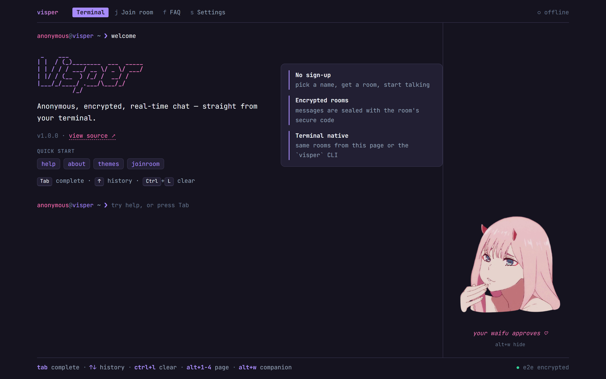
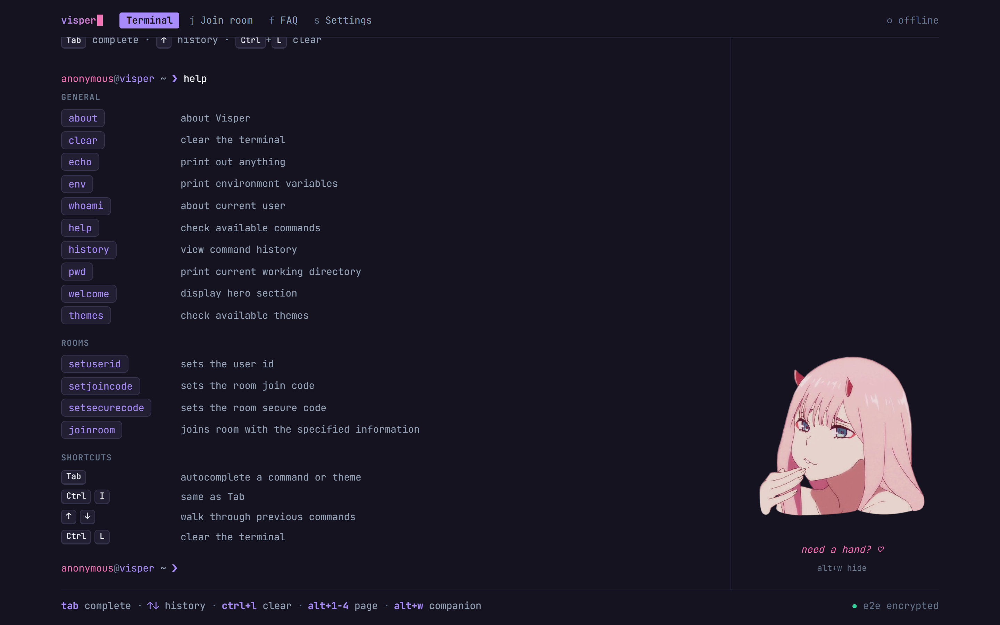
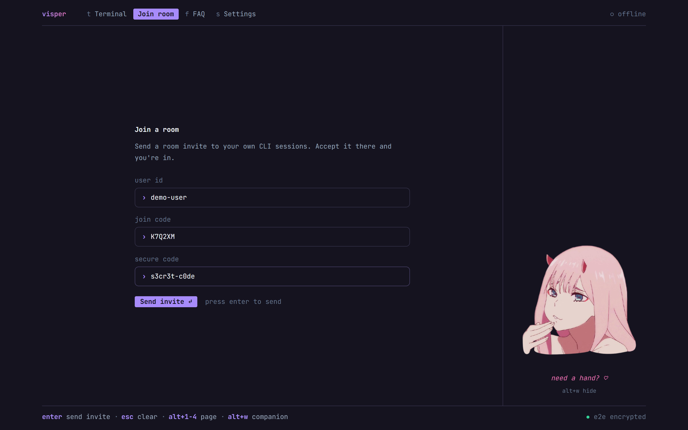
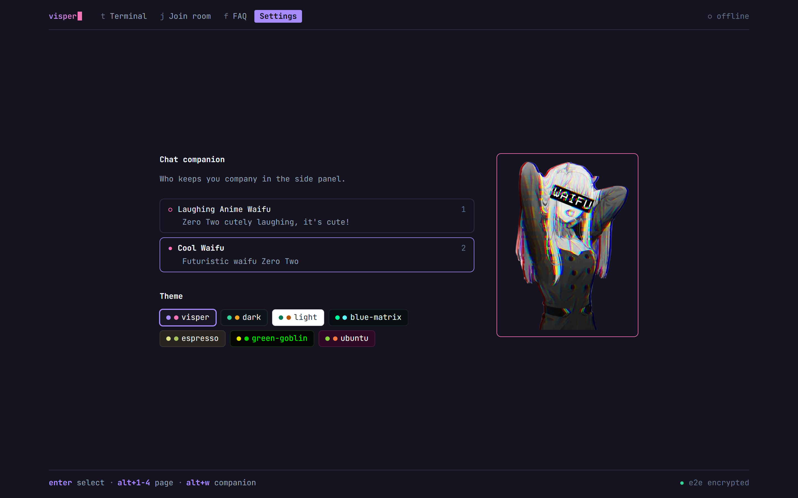
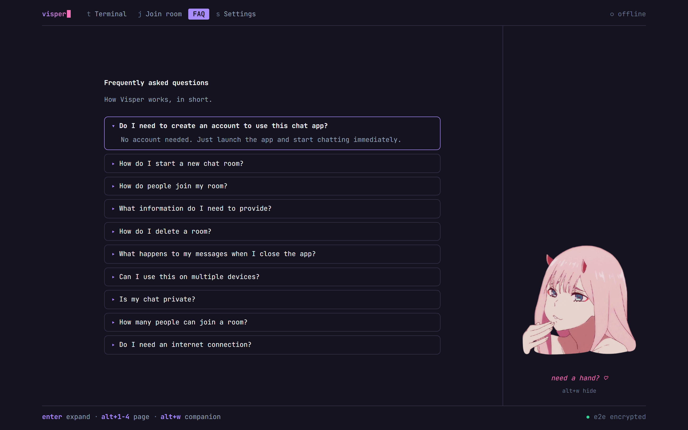
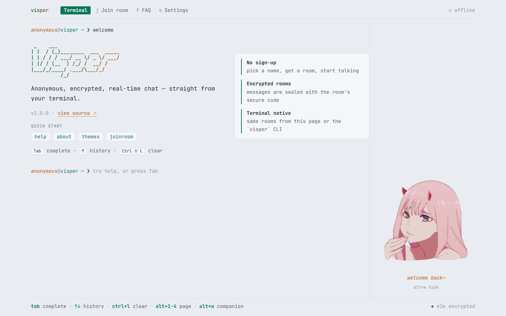
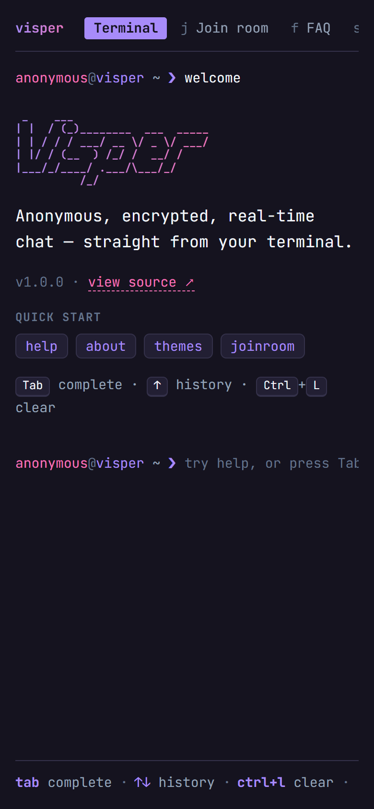

# Visper Web

Terminal-style web client for [Visper](https://github.com/HilthonTT/Visper), the anonymous, encrypted real-time chat app. The **Chat** page joins a room right in the browser (see [Chat in the browser](#chat-in-the-browser)). On the Terminal and Join room pages you type shell-like commands (`help`, `setdevicecode`, `setjoincode`, `setroomkey`, `joinroom`, `themes`, ...) to send a room invite to your own Visper CLI through the Go API. The room key is sealed to your CLI's device key (X25519 + AES-GCM, via WebCrypto) before it is sent, so the API relays it without being able to read it.

Built with React 19, TanStack Start/Router, Vite and styled-components. Every colour comes from the active theme (`src/lib/themes.ts`).

## Demos


More (reactions, replies, search, the terminal): [docs/demos](../../docs/demos/README.md#web-client).

## Screenshots

The layout follows the CLI's TUI: a header with the logo, page tabs and API status, the page in the middle, the companion on the right (wide screens, toggle with `alt+w`), and a footer with key hints.



| `help`: every command is clickable | Join room: send an invite to your CLI |
| --- | --- |
|  |  |

| Settings: companion and theme | FAQ |
| --- | --- |
|  |  |

| Light theme | Mobile |
| --- | --- |
|  |  |

Screenshots are taken at 2× with Playwright against `pnpm dev`. Retake them after visual changes.

## Pages and shortcuts

| Page | Key | What it does |
| --- | --- | --- |
| Terminal | `t` / `alt+1` | Shell-style commands (`help` lists them). Scrollback survives tab switches. |
| Chat | `c` / `alt+2` | Join a room and chat in the browser. Opens first when the URL carries `?joinCode=`. Stays connected while other pages are shown. |
| Join room | `j` / `alt+3` | Send a room invite to your CLI instead: form version of `setdevicecode` + `setjoincode` + `setsecurecode` + `setroomkey` + `joinroom`. |
| FAQ | `f` / `alt+4` | Same questions as the CLI's FAQ page. |
| Settings | `s` / `alt+5` | Pick the companion and the colour theme. Both are saved in the browser. |

Letter keys work when no text field has focus; `alt+1`–`alt+5` work anywhere. `alt+w` shows or hides the companion.

The companion images and the FAQ text are copies of the CLI's `internal/tui/embeds` files (`public/companions/`, `src/lib/companions.ts`, `src/lib/faq.ts`). Update both when one changes.

## Setup

Requires Node.js 22+ and pnpm (the version is pinned in `package.json` under `packageManager`; run `corepack enable` to use it).

```bash
pnpm install
cp .env.example .env   # then edit the values
pnpm dev               # http://localhost:3000
```

Room credentials can be prefilled from an invite link: `/?joinCode=...&secureCode=...#key=...`. The room key sits in the fragment, which browsers never send to a server; the page reads it, keeps it in memory only and removes it from the address bar. The device code comes from the CLI's settings page (press `c` there to copy it).

## Chat in the browser

Join with an invite link (`/?joinCode=…&secureCode=…#key=…`, from a CLI's `ctrl+p`) or by pasting an invite code (`ABC123.<key>`). Everything is end-to-end encrypted in the page with the room key (NaCl secretbox via [tweetnacl](https://github.com/dchest/tweetnacl-js), the same format as the Go SDK): messages, reactions and images. The key is kept in memory only, so reloading the page means joining again.

In a room:

- **Messages**: `enter` sends, `shift+enter` adds a line, `↑` in an empty box edits your last message, `esc` cancels a reply or edit. Hover a message (or tap, on touch screens) for reply, react, edit and delete.
- **Replies** quote the original message; click the quote to jump to it.
- **Reactions**: one per person per message. Clicking a reaction toggles yours.
- **Images**: `img` encrypts an image (up to 5 MB) before uploading it; image messages from the CLI are downloaded and decrypted in the page.
- **Presence and typing**: the member list shows who is connected (`members` on narrow screens), and a line under the messages shows who is typing.
- **Read receipts**: "seen by …" marks the last message each member has read. Yours is sent for the newest message while the chat is on screen.
- **Search** filters the loaded messages. It runs in the page: the server only has ciphertext, so it can't search.

The browser is identified by the API's HttpOnly `visper_user_id` cookie, which holds a private user token (a browser WebSocket can't send the `X-User-Token` header), so chat requests are sent with credentials. **The API must list this site in `VISPER_CORS_ALLOWORIGINS`** (e.g. `http://localhost:3000`): with `*`, browsers refuse to send credentials and the Chat page reports that it can't reach the API.

## Environment variables

| Variable               | Description                                                       |
| ---------------------- | ----------------------------------------------------------------- |
| `VITE_BACKEND_API_URL` | Base URL of the Visper API, no trailing slash (e.g. `http://localhost:5005`). |

Vite inlines `VITE_*` variables at build time, so set them before running `pnpm build`.

## Scripts

| Script           | What it does                                      |
| ---------------- | ------------------------------------------------- |
| `pnpm dev`       | Start the dev server on port 3000                 |
| `pnpm build`     | Production build (output in `.output/`)           |
| `pnpm preview`   | Serve the production build locally                |
| `pnpm lint`      | Lint and check formatting with Biome              |
| `pnpm format`    | Format the code with Biome                        |
| `pnpm typecheck` | Type-check with `tsc --noEmit`                    |
| `pnpm test`      | Run the unit tests with Vitest                    |

You can also run the production server directly with `node .output/server/index.mjs`.

## Layout

```
src/
  routes/       TanStack file routes (__root.tsx holds the <head>)
  components/   terminal UI, one component per command in commands/
  contexts/     user (ids/codes) and per-history-entry terminal context
  hooks/        theme, URL params, env variables
  lib/          pure helpers (command parsing, completion, API client, themes)
```
