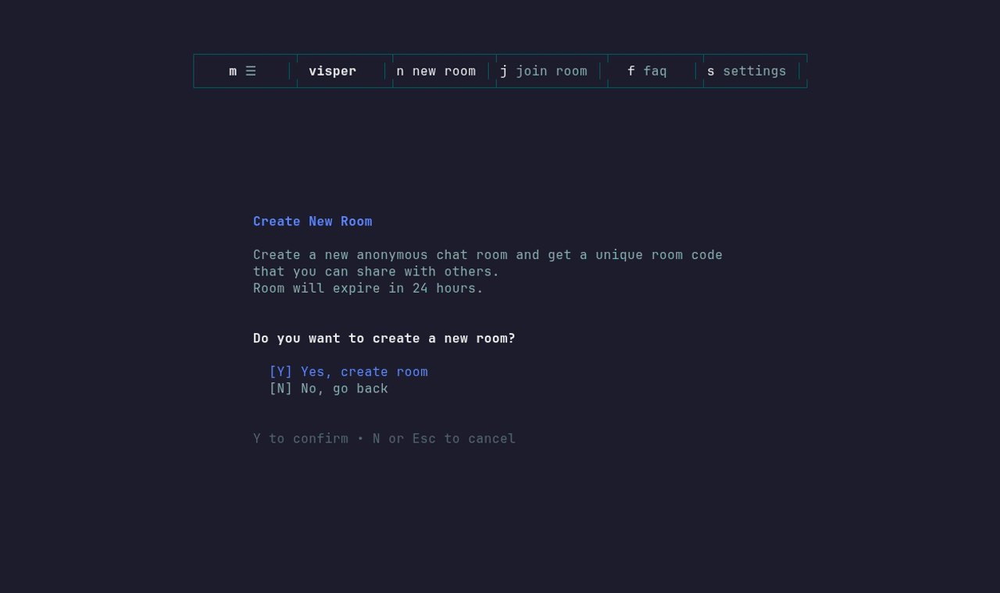
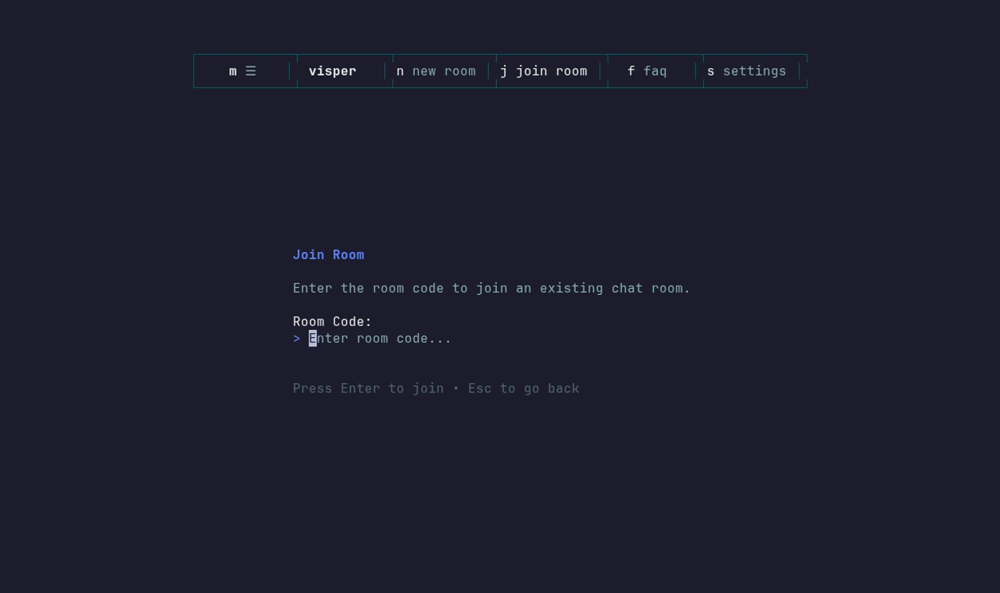
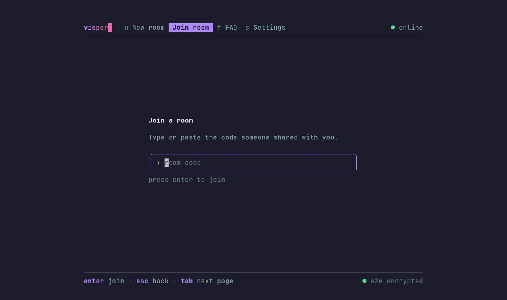
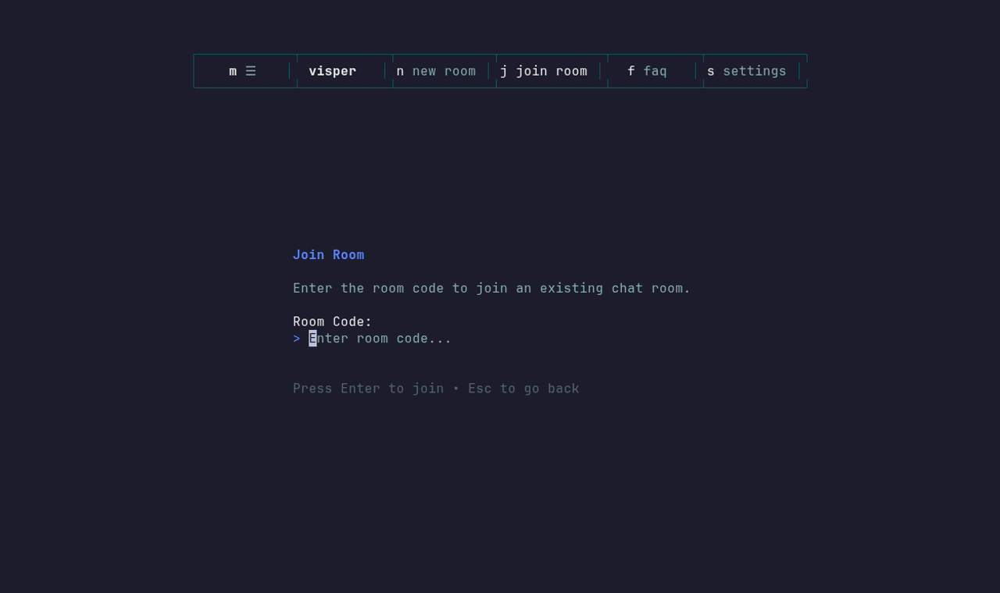
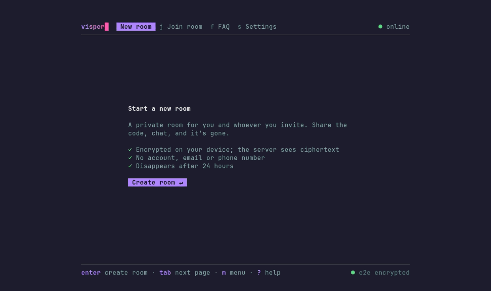

# Demos

Every GIF here is recorded from the real app against a local stack, using
[VHS](https://github.com/charmbracelet/vhs). The `.tape` files in this folder are
the scripts.

## Chat in an encrypted room

Join with a room code and talk. Messages are encrypted on the client, so the
server only stores ciphertext.


## Create a room and invite people

`n` creates a room. `Ctrl+P` shows a QR invite that carries the join code and
secure token.



## Edit and delete your messages

`Ctrl+E` enters edit mode. `↑/↓` select one of your messages, `Enter` edits it
and `Ctrl+D` deletes it.



## Share images

`Ctrl+U` opens a file picker. Images preview inline in the terminal.



## Rewrite a message with local AI

`Ctrl+A` rewrites your draft with a local [Ollama](https://ollama.com) model. The
text never leaves your machine.



## FAQ and settings

`←/→` move between the tabs; settings change the chat sidebar image.



## Re-recording

You need Docker and Go. The script runs VHS in a container, so you don't need
to install it.

```bash
docker compose --profile app up -d --build   # full stack; first run pulls the Ollama model
bash docs/demos/record.sh                    # every tape -> docs/assets/demos/*.gif
bash docs/demos/record.sh chat file-share    # just these
```

The other person in the chat demos is
[`sdk/go/examples/demo-bot`](../../sdk/go/examples/demo-bot). It creates the room,
and the script types its join code into the tape. Tapes that use
`{{JOIN_CODE}}` get a bot that replies; tapes that use `{{JOIN_CODE_SILENT}}` get
one that stays quiet.
